## José Luis Cañadas Reche {.smaller}

::: {.columns}
::: {.column width="60%"}
- Estadístico. Empecé analizando encuestas sociales en el **CSIC**
- Desde 2016 en empresa: Consultora, Telefónica, Orange e **idealista** desde 2025
- Erre-ro y bloguero desde antes de que R fuera *cool*
:::
::: {.column width="40%"}
{width="80%"}
:::
:::

---

## {.center}

::: {.r-fit-text}
Si escribe el código por mí,

**¿Me sirve entonces de algo,  saber estadística?**
:::

::: {.notes}
Es la pregunta que se está haciendo media sala. Y sobre todo los estudiantes
con el TFG a medias. Nombrarla ahora me compra su atención toda la charla.
:::

---

## {.center}

::: {.r-fit-text}
La IA **sube el suelo**.

No sube el **techo**.
:::

::: {.notes}

El suelo: Por mi cabeza pueden pasan muchas ideas, lo normal es que el 80 o 90 % las descarte, por pereza, 
por tiempo, por desconocimiento de como montar algo, o de cómo se implementa en uno u otro lenguaje

El techo: Saber interpretar lo que sale, el análisis critico. Sigue donde estaba, en lo que sabes por experiencia o formación 

Tres sitios donde uso la IA con R. El trabajo, el aula
y la piscina.
:::

## El método {.center}

::: {.r-fit-text}
Yo **dirijo** → ella **programa** y discutimos mucho → yo **verifico**
:::

::: {.notes}
No es "le pido código y lo pego".

Yo decido qué hay que calcular y con qué método. Ella escribe.
Y la verificación no es opcional ni delegable.

La charla entera es la demostración de que el primer paso y el tercero
siguen siendo míos.
:::

## Las herramientas {.smaller}

::: {.columns}
::: {.column width="50%"}
### Claude Code
Agente en terminal

- Lee y escribe ficheros de mi ordenador, consulta la web. 
- Ejecuta R, bash, python, julia, sql, lo que sea

:::
::: {.column width="50%"}
### Posit AI en Positron
**20 €/mes**

- Varios modelos. Yo uso mucho glm 5.3 Flash. Bueno, bonito y barato
- Integrado en **Positron y RStudio**
- **Lee del REPL**: ve tu sesión
- No hay que irse a la terminal
:::
:::

::: {.callout-note}
Si sois analistas y no vivís en la terminal (aunque deberíais ), **esta segunda es la que os
recomiendo**: vive dentro del IDE donde ya trabajáis.
:::

<!-- TODO(JL): confirmar modelos disponibles y precio vigente en noviembre 2026 -->

# 1 · El trabajo {background-color="#1a3a5c"}

Informes `.qmd` analíticos y el informe catastral

## El problema no es el análisis {.smaller}

Negocio me pedía una y otra vez comprobar lo mismo. Tenía que consultar BD, el modelo, etc..
Así que cree una skill de claude enseñando lo que quería hacer y cómo. 

Pero **el mismo análisis tenía dos audiencias distintas*.

::: {.columns}
::: {.column width="50%"}
### Equipo técnico (yo mismo ) → repo
El código, los supuestos, el detalle reproducible, para ver si la había cagado
:::
::: {.column width="50%"}
### Negocio → Confluence
La conclusión, el gráfico, las comparativas,  y ni una línea de R, ni se sql, 
:::
:::

. . .

Antes: Hacer el análisis y luego ponerlo en "bonito", y muchas veces, solo hacía lo primero

## El flujo real {.smaller}

1. **Yo decido** el análisis y le digo **que sea en R** *(o python o sql o lo que sea, no hay miedo)*
2. **Ella, (¿estoy humanizando?) escribe** el `.qmd`
3. **Yo verifico los resultados** — no el estilo del código
4. Le pido **dos salidas del mismo documento**: técnica para el repo, negocio para Confluence

<!-- TODO(JL): ¿cómo resuelves las dos versiones? params de Quarto, perfiles,
     chunks condicionales... Concrétalo: es lo que la gente va a querer copiar -->

::: {.notes}
El informe catastral es el mejor ejemplo. Recuperar slides de charla granada.

Qué es: le das una referencia catastral y compara lo que predice nuestro
modelo de valoración (AVM) para esa vivienda con los anuncios comparables de
su zona, mes a mes, desde enero de 2025.

Por qué era buen candidato: se repite para muchas referencias, siempre con la
misma estructura, y lo leen técnicos y negocio.
:::

## {.smaller}

### El informe catastral

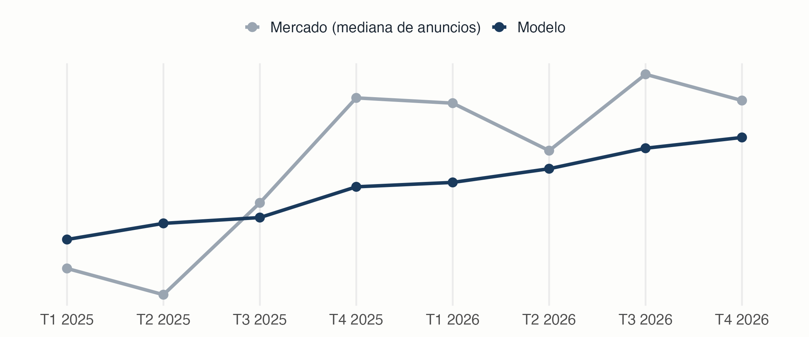{fig-alt="Evolución trimestral de 2025 a 2026 del precio que predice el modelo para una vivienda frente a la mediana de los anuncios comparables. Sin eje de euros." width="95%"}

*Una vivienda real. Sin euros, sin zona.*

::: {.notes}
Modelo: predicción del AVM para esa referencia catastral, por trimestre (columna price_model_cadastre del informe).
Mercado: mediana trimestral del precio de los anuncios comparables de la zona.
Gráfico generado con `scripts/grafico_informe_catastral.R` (mismo que Málaga).
:::

## Dónde está el techo: **verificar** {.smaller}

<!-- TODO(JL): 1-2 errores REALES de la IA. Los mejores son del tipo:
     - agregó mal
     - eligió el estadístico equivocado
     - ignoró los NA
     - se inventó un supuesto
     - "funcionaba" pero contestaba a otra pregunta
     No errores de sintaxis: esos los caza R solo. -->

::: {.callout-important}
## Error real
En una tabla, las filas cambiaron de orden.

Los totales de Andalucía no cuadraban. 


:::

::: {.notes}
Sin capturas: el informe es confidencial. Lo cuento.
Lo vi yo porque sabía qué total esperaba.
:::

. . .

::: {.r-fit-text}
El código compilaba.

El informe era bonito.

**El número estaba mal.**

:::

. . .

Nadie de negocio lo habría notado.

## Qué puso el estadístico

**Decidir** qué se calcula, con qué método y con qué supuestos.

**Comprobar** que el resultado es correcto.

**Skill** tuve que reenseñar como hacerlo


. . .

La IA subió el suelo en la parte que odiaba —la segunda versión del documento,
la que antes no se hacía— y **no tocó el techo**.

# 2 · El aula {background-color="#1a3a5c"}

Con un amigo mío profe, discutíamos sobre como enseñar muestreo. Y de ahí en una tarde surgió el  simulador de encuestas electorales

## Explicar lo difícil de explicar

> ¿Por qué dos encuestas **honestas y bien hechas** dan resultados distintos?

Es un concepto importante pero díficil dde contar en una clase.
Con unos **dibujitos** se entiende a la primera 


. . .

::: {.callout-warning}
## Que quede claro
**La app muestrea correctamente.** Es una herramienta docente que funciona.

El error que os enseñaré no está en el muestreo.
:::

## Qué me dio la IA {.smaller}

Toda la fontanería, la que yo elegí: Shiny con reactividad, layout, sliders, gráficos, el pulido. 

Horas de trabajo que **no son estadística**.

. . .

Y que es la razón por la que muchos docentes nunca llegan a
construir su material interactivo.

. . .

::: {.r-fit-text}
La barrera para que un profesor tenga

su propio simulador **acaba de desaparecer**
:::

::: {.notes}
Cómo lo construí, contado en el blog (8 mar 2026):
https://muestrear-no-es-pecado.es/2026/03/sim_encuestas_claude_code.html
:::

## Demo {.center background-color="#0f2233"}

::: {.r-fit-text}
Tres ejemplos
:::

::: {.notes}
GUION CERRADO. 10 minutos. Detalle completo en guion.md.
https://canadasreche.shinyapps.io/sim-encuestas-electorales/
Antes: app abierta, una ejecución hecha, zoom 125 %, n = 1.200, 500 réplicas.

0. POBLACIÓN (1 min). Pestaña Población, gráfico de voto por edad.
   "España inventada. Conozco el voto de todos." Jóvenes: más Sumar y Vox.
1. N (2,5 min). n = 400, Ejecutar, Distribuciones PP. Luego n = 4.000.
   OJO: el eje se reajusta solo. Señalar los números: 27-37 frente a 30-34.
   "10 veces más entrevistas, la dispersión baja a la tercera parte."
2. NO RESPUESTA (2,5 min). n = 1.200, marcar no respuesta, Ejecutar.
   Resultados Agregados: n efectivo ~800; PP y PSOE arriba, Vox y Sumar abajo.
   "El problema no es a quién llamas, es quién te coge el teléfono." Silencio.
3. PONDERAR (1,5 min). Marcar ponderación. Tarda ~40 s: explicar mientras.
   Sesgo del PP vuelve a ~0; la SD sube.
4. VOTANTE OCULTO (2 min). Desmarcar no respuesta y ponderación, marcar
   deseabilidad. Distribuciones, Vox.
   Línea roja en la cola. "Más muestra no lo arregla."

PLAN B: si no arranca en 15 s, o una simulación se cuelga, paso a las capturas.
:::

## Plan B · 1. Tamaño de muestra {visibility="uncounted" .smaller}

500 encuestas simuladas sobre la misma población. Estimación del PP.

::: {.columns}
::: {.column width="50%"}
**n = 400**

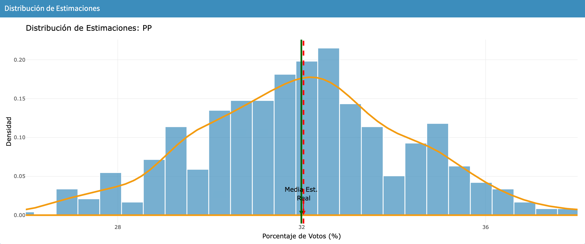{fig-alt="Histograma de 500 estimaciones del PP con n igual a 400, entre 27 y 37 por ciento"}
:::
::: {.column width="50%"}
**n = 4.000**

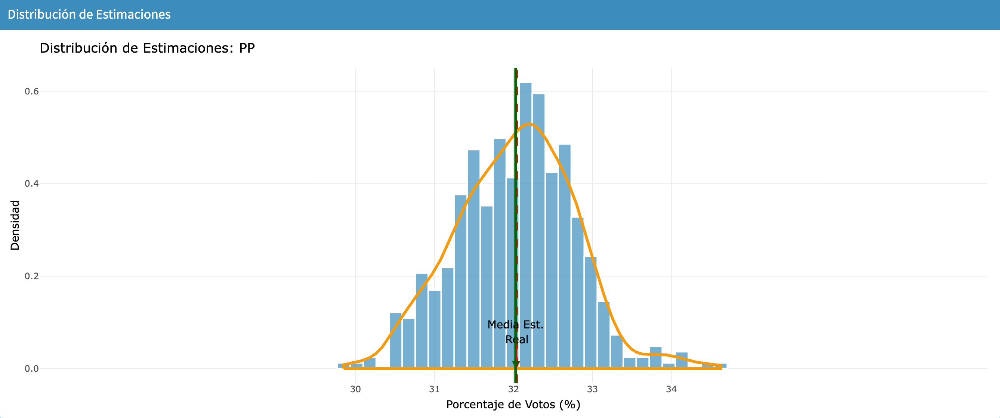{fig-alt="Histograma de 500 estimaciones del PP con n igual a 4000, entre 30 y 34 por ciento, mismo eje"}
:::
:::

. . .

10 veces más entrevistas. La dispersión solo baja a la tercera parte.

::: {.notes}
Mismo eje X en los dos (26 % a 38 %). Valor real del PP: 32,04 %.
Desviación típica de las 500 estimaciones: 2,31 pp con n = 400 y 0,75 pp con n = 4.000.
2,31 / 0,75 = 3,1, que es casi raíz de 10 = 3,16.
Probabilidad de acertar el ganador: 61 % con n = 400 y 79 % con n = 4.000.
:::

## Plan B · 2. No respuesta {visibility="uncounted" .smaller}

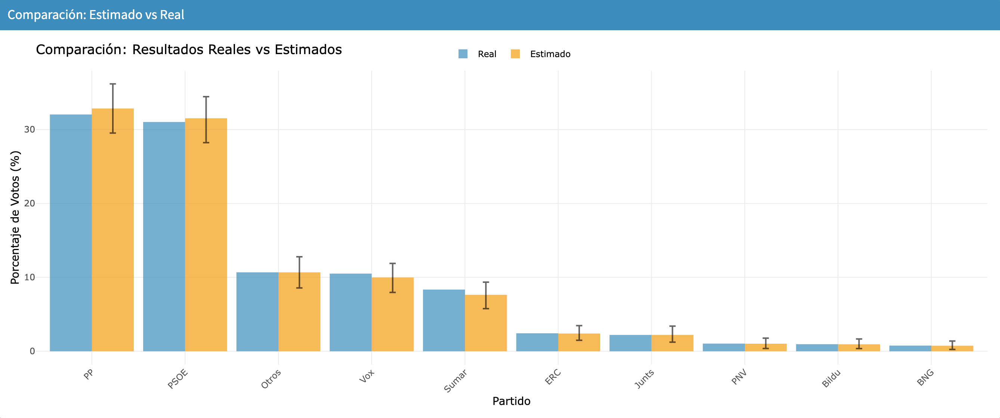{fig-alt="Barras de voto real frente a estimado con sesgo de no respuesta por edad: PP y PSOE sobreestimados, Vox y Sumar infraestimados" width="85%"}

El muestreo es correcto. **La realidad no ha cambiado.** Y la estimación se mueve.

::: {.notes}
Qué hace la app, en tres pasos:
1. Saca una muestra aleatoria simple de 1.200 personas. Esto está bien hecho.
2. Cada persona contesta o no según su edad: 40 % de 18-24, 50 % de 25-34,
   60 % de 35-44, 70 % de 45-54, 80 % de 55-64 y 85 % de 65+.
3. Calcula el voto solo con los que contestan. Quedan unas 800 (un tercio no contesta).

Por qué se mueve la estimación:
- Los que contestan son más mayores que la población.
- En la población simulada, los jóvenes votan más Vox y Sumar,
  y los mayores votan más PP y PSOE.
- Resultado: la encuesta oye de más a los mayores. Sube PP y PSOE, baja Vox y Sumar.

Cifras (estimado − real, en puntos): PP +0,81, PSOE +0,50, Vox −0,52, Sumar −0,71.

La frase: nadie ha mentido y el muestreo es correcto.
El problema no es a quién llamas, es quién te coge el teléfono.

Cómo leer el gráfico: barra azul = voto real; naranja = media de las 500 encuestas.
La rayita negra cubre el 95 % central de las 500 estimaciones (no es un intervalo de una sola encuesta).

Si preguntan "¿y si pido más muestra?": no se arregla. Con más n, las encuestas
se equivocan igual, pero todas en el mismo sitio.
El arreglo es ponderar por edad y sexo: lo enseño en "La cocina".
:::

## Plan B · 3. Votante oculto {visibility="uncounted" .smaller}

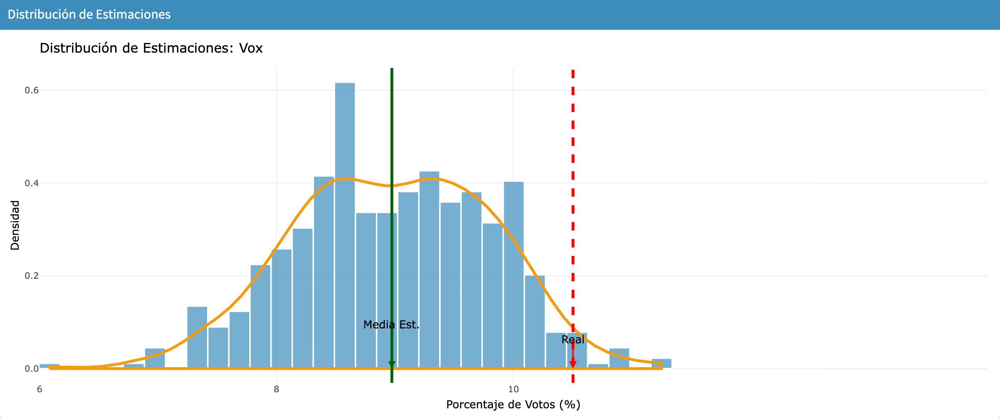{fig-alt="Histograma de 500 estimaciones de Vox con sesgo de deseabilidad social: la media estimada, 9 por ciento, queda a la izquierda del valor real, 10,5 por ciento" width="85%"}

Casi todas las encuestas se quedan **por debajo** del valor real.

::: {.notes}
Sesgo de deseabilidad social en Vox, n = 1.200, 500 réplicas.
Real 10,50 %; media de las estimaciones 8,97 %; diferencia −1,53 puntos.
El percentil 97,5 de las réplicas es 10,50 %: el valor real queda justo en el borde.
Más muestra no lo arregla: el sesgo no baja con n.
:::

## Plan B · Los escenarios juntos {visibility="uncounted" .smaller}

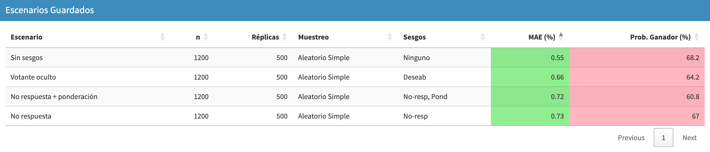{fig-alt="Tabla de cuatro escenarios con n igual a 1200 y 500 réplicas: error medio absoluto y probabilidad de acertar el ganador"}

::: {.notes}
MAE = media, sobre los 10 partidos y las 500 réplicas, de |estimado − real|, en puntos.
El MAE apenas sube (0,55 a 0,73) porque promedia 10 partidos y 6 casi no se mueven.
Ponderar corrige el sesgo (PP de +0,81 a −0,01) pero no baja el MAE (0,72):
la varianza sube porque solo quedan 800 entrevistas efectivas.
Capturas generadas con `scripts/capturas_simulador.R`.
:::

## La Ayuda sonaba perfecta {.smaller}

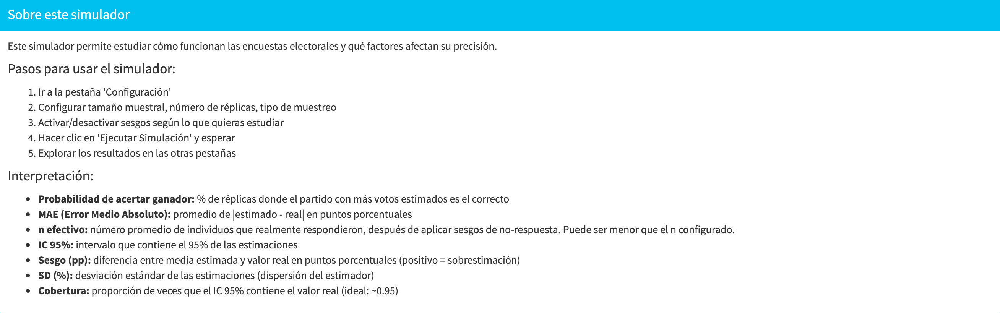{fig-alt="Texto de la Ayuda de la app: Cobertura, proporción de veces que el IC 95 % contiene el valor real, ideal 0,95" width="90%"}

. . .

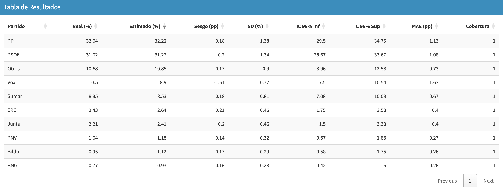{fig-alt="Tabla de resultados con votante oculto: Vox con sesgo de menos 1,61 puntos y cobertura 1" width="90%"}

. . .

Vox: sesgo de **−1,6 puntos** y cobertura **1**. Eso no puede ser.

::: {.notes}
Lo escribió la IA, confirmado por mí.
La Ayuda define cobertura bien, como en un libro.
El código hace otra cosa:
- Junta las 500 estimaciones y calcula UN solo intervalo:
  del percentil 2,5 al percentil 97,5.
- Mira si el valor real cae dentro. Pone 1 si cae, 0 si no.
Eso responde "¿el valor real es un resultado posible?". No es una cobertura.
Por eso Vox, con sesgo −1,6 puntos, sale con cobertura 1.
Siguiente diapositiva: cómo se hace bien.
:::

## La cobertura, bien calculada {.smaller}

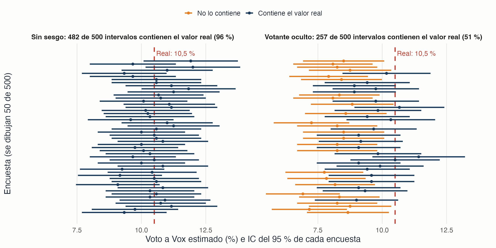{fig-alt="Dos paneles con 50 intervalos de confianza del 95 por ciento para el voto a Vox. Sin sesgo, 482 de 500 contienen el valor real de 10,5 por ciento. Con votante oculto, solo 257 de 500" width="95%"}

Un intervalo **por encuesta**. Cuento cuántos tocan el valor real.

::: {.notes}
Cómo se calcula bien, en tres pasos:
1. Cada encuesta da su estimación p y su IC 95 %: p ± 1,96 × raíz(p(1 − p) / n).
2. Miro si el valor real (10,5 %) cae dentro de ese intervalo.
3. Cobertura = intervalos que lo contienen / total de encuestas.

Sin sesgo: 482 de 500 = 96 %. Lo que promete un IC del 95 %.
Votante oculto: 257 de 500 = 51 %. Media de las encuestas que dicen "95 %
de confianza" no contienen el valor real.

La app pondría 1 en los dos casos.

Método: simulación propia, no sale de la app. 500 encuestas de n = 1.200.
Proporción declarada: 10,5 % sin sesgo; 8,9 % con votante oculto
(la media que dio la app). Se dibujan 50 de las 500.
Script: scripts/grafico_cobertura.R.

Frase: el texto de la Ayuda era convincente. El número no significaba eso.
Solo lo ve quien sabe qué es una cobertura.
:::

## La **cocina** {.smaller}

Lo que antes hacía el CIs muy bien y ahora un poquito menos bien:
ponderar y modelizar.

. . .

- La ponderación post-estratificación **ya está en la app**. Corrige la no respuesta.
- Modelar y  con varias encuestas y MRP, está en el blog:

[MRP con varias encuestas (I): nueve encuestas y una tabla de postestratificación](https://muestrear-no-es-pecado.es/2026/11/mrp-multiencuesta/)

::: {.notes}
Lo digo YO antes de que me lo pregunten.
Dato de la demo: ponderar lleva el sesgo del PP de +0,81 a −0,01 puntos,
pero el MAE no baja (0,73 a 0,72): quedan unas 800 entrevistas efectivas.
Si preguntan por raking: https://muestrear-no-es-pecado.es/2026/10/mrp-raking/
Parte II del MRP: https://muestrear-no-es-pecado.es/2026/11/mrp-multiencuesta/ii-modelo.html
:::

## Octubre de 2026 {.smaller}

| Periodo | Posts en el blog |
|---|---|
| Enero a septiembre de 2026 (9 meses) | 7 |
| Octubre de 2026 (1 mes) | **7** |

Meta-análisis, escaños, MRP, modelo bayesiano completo. Todos asistido con IA, antes me habría llevado semanas hacerlo. 

. . .

¿Es la IA o son las generales del 29-N?

**Soy estadístico: no puedo separar los dos efectos.**

::: {.notes}
Método: posts por mes según el RSS del blog (blog.xml), consultado el 3 nov 2026.
Enero 2026: 3 (Cachitos), marzo: 1, mayo: 2, julio: 1. Octubre: 7.
Los de octubre son con IA asistida (lo sé yo, no lo dice el RSS).
El chiste es serio: hay una variable de confusión, las elecciones.
Es el suelo subiendo, y también un ejemplo de interpretar.
:::

## Qué puse yo como estadístico: el **diseño** {.smaller}

El muestreo estaba bien. El error estaba en una definición que sonaba perfecta.

. . .

**Qué sesgos merece la pena simular. Cómo se formalizan. Qué tiene que ver
el alumno en pantalla para que le haga clic.**

Eso no sale de un modelo. Sale de haber analizado encuestas y de haber
intentado explicárselas a alguien.

. . .

::: {.r-fit-text}
La IA construye el simulador.

**Lo que simular, lo pones tú.**
:::

# 3 · La piscina {background-color="#1a3a5c"}

Mis datos de natación del Garmin
[Enlace](https://canadasreche.shinyapps.io/mi-garmin-dashboard/)

## Un análisis que no le importa a nadie

Nado desde hace un año y pico. El reloj mide desde finales de diciembre de 2025.

190 sesiones que nunca habría analizado en serio.

. . .

No le importa a nadie. No lo paga nadie. No cabe en un fin de semana.

. . .

**Y ese es justamente el argumento.**

## Qué me dio la IA {.smaller}

Descarga, limpieza de los datos del Garmin, exploración, gráficos. Y un panel.

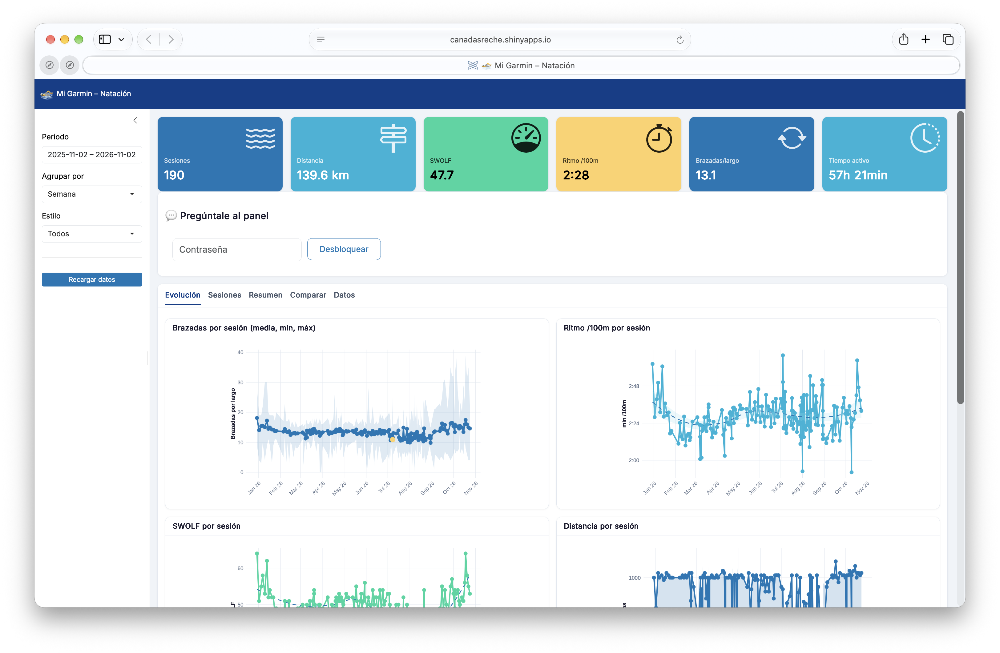{fig-alt="Panel Shiny 'Mi Garmin – Natación' con 190 sesiones y 139,6 km en el último año, y gráficos de brazadas y ritmo por sesión" width="80%"}

<!-- TODO(JL): 1-2 hallazgos concretos sobre tu natación. Cuanto más personal
     y sorprendente, mejor: aquí el público está relajado y es cuando más se
     acuerdan de lo que dices -->

::: {.notes}
Datos del reloj desde finales de diciembre de 2025 (el filtro del panel dice 2025-11-02 a 2026-11-02). 190 sesiones, 139,6 km,
57 h 21 min de tiempo activo.
https://canadasreche.shinyapps.io/mi-garmin-dashboard/
:::

## {.center}

::: {.r-fit-text}
Este es el caso donde **el suelo sube más**
:::

Un análisis que no se habría hecho jamás, ahora existe.

No porque sea difícil: porque nunca habría merecido las horas.

## Pregúntale al panel {.smaller}

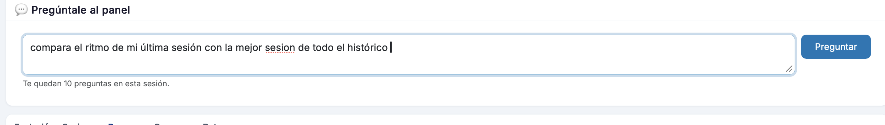{fig-alt="Caja de texto con la pregunta: compara el ritmo de mi última sesión con la mejor sesión de todo el histórico"}

. . .

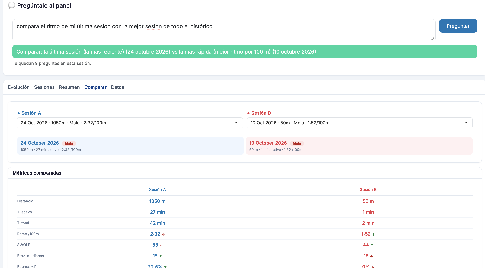{fig-alt="El panel responde: compara la sesión del 24 de octubre de 2026, 1050 m a 2:32 por 100 m, con la del 10 de octubre de 2026, 50 m a 1:52 por 100 m, y abre la pestaña Comparar" width="85%"}

::: {.notes}
Dentro del panel hay un modelo de IA (jev). No escribe texto: decide una
acción sobre el propio dashboard. Pone filtros, elige sesiones y cambia de
pestaña. Aquí ha ido a "Comparar" y ha rellenado la sesión A y la B.

Contraseña  y límite de 10 preguntas por sesión, que JEV es barato, pero por si acaso
:::

## Qué puso el estadístico: **interpretar** {.smaller}

El panel contestó **exactamente** lo que le pregunté.

| | Última sesión | "La mejor" |
|---|---|---|
| Fecha | 24 oct 2026 | 10 oct 2026 |
| Distancia | 1050 m | **50 m** |
| Tiempo activo | 27 min | **1 min** |
| Ritmo | 2:32 /100 m | 1:52 /100 m |

. . .

La "mejor sesión" es **un largo**. Comparo un esprint con una sesión entera.

La pregunta buena era otra: *la mejor sesión de más de 1000 m*.

. . .

::: {.r-fit-text}
La respuesta llegó en diez segundos.

**La pregunta la puse yo.**
:::

::: {.notes}
Nadie se equivocó: la IA tomó "mejor" como "ritmo más bajo", que es lo que
dije. Lo que faltaba es lo que sabe un estadístico: comparar cosas comparables.
Si le pongo un mínimo de distancia, la comparación ya tiene sentido.
<!-- TODO(JL): probar la pregunta con "de más de 1000 m" y, si sale bien, captura -->
:::

# Extra: estas diapositivas {background-color="#1a3a5c"}

Solo si voy bien de tiempo

::: {.notes}
USAR SOLO SI LLEGO AQUÍ ANTES DEL MINUTO 42. Si no, saltar al Cierre.
Son 3 minutos.
:::

## Estas diapositivas también son IA {.smaller}

Le pedí las capturas del simulador. **Escribió R que maneja la app** por mí (versión resumida):

```r
library(chromote)
b <- ChromoteSession$new()
b$Page$navigate("https://canadasreche.shinyapps.io/sim-encuestas-electorales/")
js <- function(x) b$Runtime$evaluate(x)$result$value
js("$('#sesgo_no_respuesta').prop('checked', true).trigger('change')")
js("$('#ejecutar').click()")
b$screenshot("encuesta-norespuesta.png", selector = "#grafico_comparacion")
```

Abre Chrome sin ventana, marca las casillas, pulsa Ejecutar, espera y hace la foto.

Y además midió cuánto tarda cada simulación y leyó el código de la app en GitHub.

::: {.notes}
Script completo: scripts/capturas_simulador.R (repo charla_siguenza).
Lo hizo Claude Code en una sesión de trabajo conmigo, el 2 y 3 de nov de 2026.
Yo no sabía usar chromote. Ese es el suelo subiendo otra vez.
:::

## Y también se equivocó {.smaller}

| Qué hizo mal | Cómo se vio |
|---|---|
| Las capturas salían **un escenario retrasadas** | Las tablas eran idénticas con y sin sesgo |
| Iba a publicar la **referencia catastral** en un script | Revisión antes de subir a GitHub |
| Dijo que mis posts de octubre **no eran con IA** | Lo corregí yo: lo sabía |

. . .

::: {.r-fit-text}
Yo dirijo → ella programa → **yo verifico**.

También aquí.
:::

::: {.notes}
1. Capturas retrasadas: el script esperaba al texto "Simulación completada",
   pero ese texto seguía en pantalla de la ejecución anterior. Hacía la foto
   antes de que acabara la nueva. Las imágenes eran bonitas y estaban mal.
   Se vio porque los números no cambiaban al activar los sesgos.
   Lo detectó la propia IA al revisar las cifras; luego corrigió la espera.
2. Referencia catastral: estaba dentro de la ruta del CSV en el script del
   gráfico anónimo. Se vio al buscarla en todo lo que se iba a subir.
3. Posts de octubre: dedujo "no hay IA" porque los commits no llevaban
   Co-Authored-By. Ausencia de evidencia no es evidencia de ausencia.
Es la misma historia de toda la charla: el error plausible solo lo ve quien
sabe qué número esperar.
:::

# Cierre {background-color="#1a3a5c"}

## Qué hace bien y qué hace mal {.smaller}

::: {.columns}
::: {.column width="50%"}
### Bien
- Carpintería: Shiny, Quarto, boilerplate, docs
- Traducir entre formatos y audiencias
- Bajar el coste de **empezar** algo
- Hacer posible lo que no compensaba
:::
::: {.column width="50%"}
### Mal
- Elegir el método correcto
- Los supuestos que nadie escribió
- Decirte **cuándo su respuesta está mal**
- Saber qué pregunta había que hacer
:::
:::

## Las tres preguntas {.greater}

::: {.incremental}
1. **¿Es esta la pregunta correcta?**
2. ¿Es este el método correcto para responderla?
3. **¿Es creíble este resultado?**
:::

. . .

Un modelo te ayuda con la segunda —si tú ya la sabes plantear.

La primera y la tercera son **enteramente tuyas**.

## {.center}

::: {.r-fit-text}
La IA sube el suelo.

**El techo lo sigues poniendo tú.**
:::

## {.center .smaller}

::: {.r-fit-text}
Por eso hay que seguir

enseñando **estadística**
:::

<br>

Si la carpintería la hace la máquina, lo único que te distingue es el criterio.

Que es lo que se enseña aquí.

## Gracias {.center}

**José Luis Cañadas Reche**

idealista · Senior Data Scientist

<br>

::: {.smaller}
Blog: [muestrear-no-es-pecado.es](https://muestrear-no-es-pecado.es/blog)

GitHub: [github.com/joscani](https://github.com/joscani)

Bluesky: [@joscani.muestrear-no-es-pecado.es](https://bsky.app/profile/joscani.muestrear-no-es-pecado.es)

Mastodon: [@joscani@fosstodon.org](https://fosstodon.org/@joscani)

X: [@joscani](https://x.com/joscani)

Diapositivas: [github.com/joscani/charla_siguenza](https://github.com/joscani/charla_siguenza)
:::
